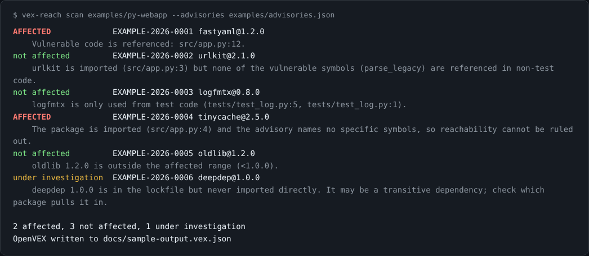

# vex-reach

Most vulnerability scanners tell you *"you have fastyaml 1.2.0, and it has a CVE"*. They cannot tell you whether your code ever calls the vulnerable function, so teams drown in alerts and ignore the list. **vex-reach** takes the advisory list, your lockfile and your source, and produces an **[OpenVEX](https://openvex.dev)** document that says, per vulnerability: *affected*, *not affected (and why)*, or *under investigation*.

Rust, zero dependencies, one small binary.



## What it decides

| Situation | Status | Justification |
|---|---|---|
| Package is not in any lockfile | `not_affected` (only with `--include-absent`) | `component_not_present` |
| Pinned version is outside the affected range | `not_affected` | `vulnerable_code_not_present` |
| In range, a vulnerable symbol is referenced in non-test code | `affected` | action: upgrade to the fixed version |
| In range, advisory names no symbols, package is imported | `affected` | reachability cannot be ruled out |
| In range, package imported, vulnerable symbols never referenced | `not_affected` | `vulnerable_code_not_in_execute_path` |
| In range, referenced only from tests | `not_affected` | `vulnerable_code_not_in_execute_path` |
| In range, never imported (probably transitive) | `under_investigation` | says which dependent to check |

Every statement carries the file and line it is based on, so a reviewer can verify it in seconds.

## Usage

```bash
cargo build --release
vex-reach scan ./my-project --advisories advisories.json --out vex.json --md report.md
vex-reach check vex.json                       # validate an OpenVEX document
vex-reach scan . --advisories a.json --fail-on affected    # exit 1 for CI gates
```

Options: `--author`, `--timestamp` (fixed value for reproducible output), `--include-absent`, `--fail-on affected|under_investigation`. Exit codes: 0 ok, 1 gate tripped, 2 usage or input error.

## Inputs

**Lockfiles** found anywhere under the project (dependency and build directories skipped, symlinks never followed): `requirements*.txt` (pinned `==`), `package-lock.json` (v1 and v2/v3), `Cargo.lock`, `go.mod`.

**Source** in Python, JavaScript/TypeScript, Go and Rust.

**Advisories** are a JSON file. You can generate it from any feed; the fields that matter for reachability are `symbols`:

```json
{"advisories": [{
  "id": "EXAMPLE-2026-0001", "ecosystem": "pypi", "package": "fastyaml",
  "affected": ["<1.4.0"], "fixed": "1.4.0",
  "symbols": ["load_unsafe"], "severity": "high",
  "summary": "load_unsafe constructs arbitrary objects from untrusted YAML."
}]}
```

`affected` is a list of ranges (OR), each a comma-separated AND of `<`, `<=`, `>`, `>=`, `==`, `!=`. `symbols` use `.` (or `::` for Rust), relative to the package: `Loader.load`, `codec::decode`. Optional `modules` lists import roots when they differ from the package name. The advisories in `examples/` are invented (fictional packages and ids), made to exercise each outcome.

## How the reachability check works

1. Strip comments and string contents, so `# fy.load_unsafe(x)` and `"fy.load_unsafe("` never count.
2. Read each file's imports (`import x as y`, `from x import (a, b as c)`, `require`, destructuring, `import * as`, Go import blocks and aliases, Rust `use` trees).
3. For each vulnerable symbol, search for it **through the names those imports bind** (alias, named import, or full path), as a whole token path.
4. Ignore import lines, test files and dependency directories.

## What it does not do

This is textual analysis, not a call graph, and it is conservative in one direction only.

- A reference means the symbol is **used**, not that it **runs**. Dead code still reports `affected`.
- Calls through objects (`client = fy.Client(); client.load_unsafe()`), `getattr`, dynamic `import()`, reflection and macros are not followed. Those can produce a false "not affected". Treat `not_affected` as "no reference found", and review high severity ones.
- Wildcard imports are treated as using every symbol.
- Transitive dependencies are reported as `under_investigation`, not resolved.
- It does not fetch advisories. Bring your own feed.

## Layout

```text
src/json.rs        JSON parser and printer (no serde)
src/version.rs     version ordering and range matching
src/advisory.rs    advisory loading and validation
src/manifest.rs    lockfile discovery and parsing
src/scan.rs        comment/string stripping, import parsing, symbol search
src/vex.rs         decisions, OpenVEX document, SHA-256, timestamps
src/report.rs      terminal and Markdown output
examples/          four small projects and an advisory file
docs/              sample OpenVEX output and report
```

37 tests, including a check that the emitted document satisfies the OpenVEX rules this tool relies on (`affected` needs an action statement, `not_affected` needs a justification) and that output is byte-identical for identical input.

MIT licensed.
